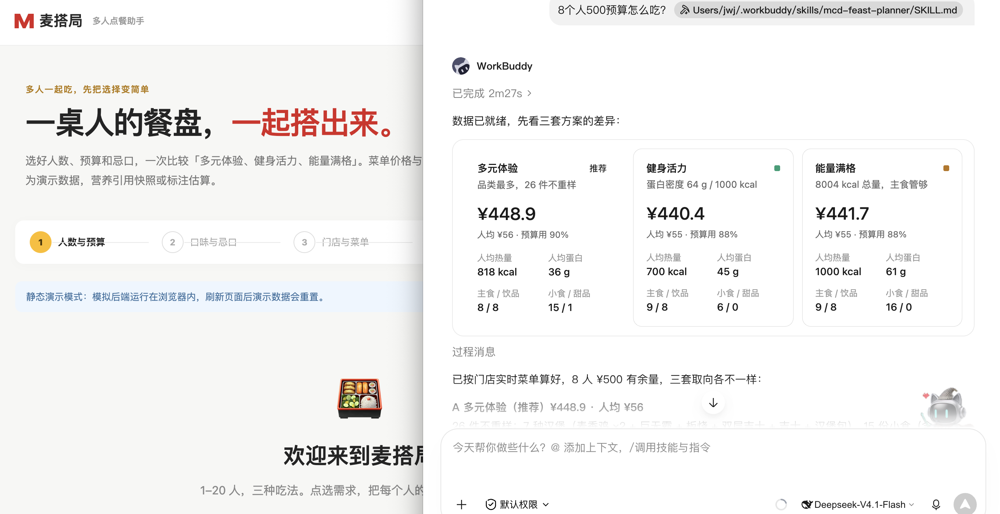

# 作品讲解

本仓库含有两个作品，是麦搭局的两个实现：一个是代码实现，还有一个是 skills 实现。

- **代码实现**：可以本地部署，也可以使用云端的静态部署。目前已部署，体验网址是：https://auulb.github.io/maidaju/
- **Skills 实现**：需要下载 https://github.com/auulb/maidaju/blob/main/mcd-feast-plannerv2.0.zip 到本地并导入到 Work Buddy 开始对话
- **代码和 skill 的存放仓库**是：https://github.com/auulb/maidaju/tree/main

# 用法讲解
给人数预算还有忌口之后，能够快速的按照三个方向给出选择：

- **多元体验**：尽可能多地给出更多选择；
- **健身活力**：精确计算营养蛋白质比值，给出蛋白质更多的选择；
- **能量满格**：尽量做到能量最大化。

